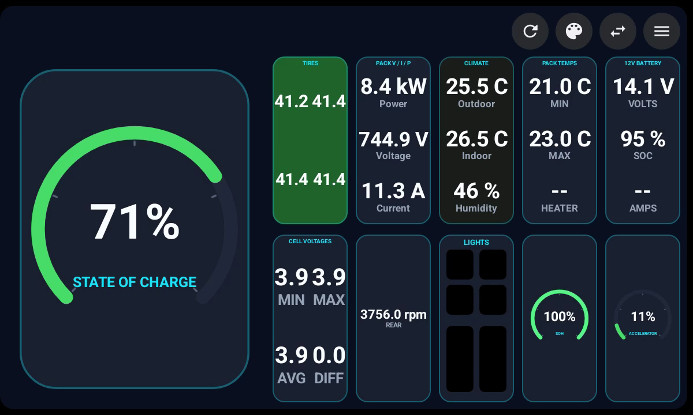
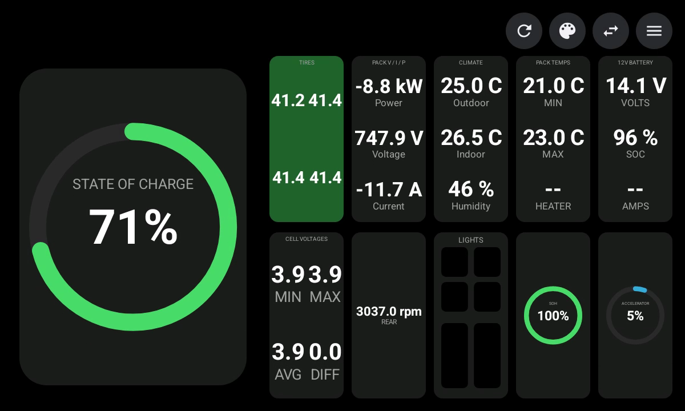
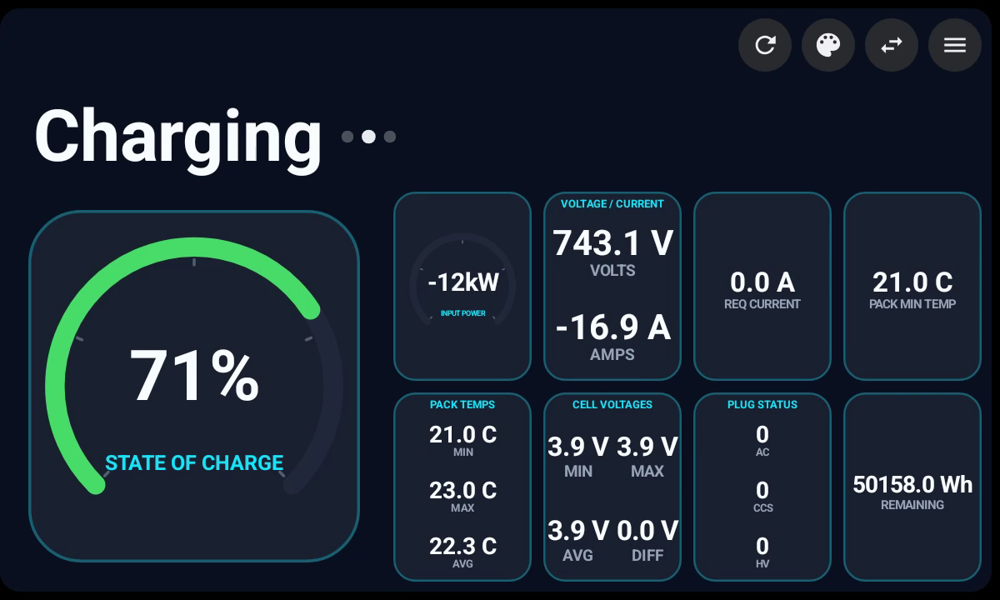
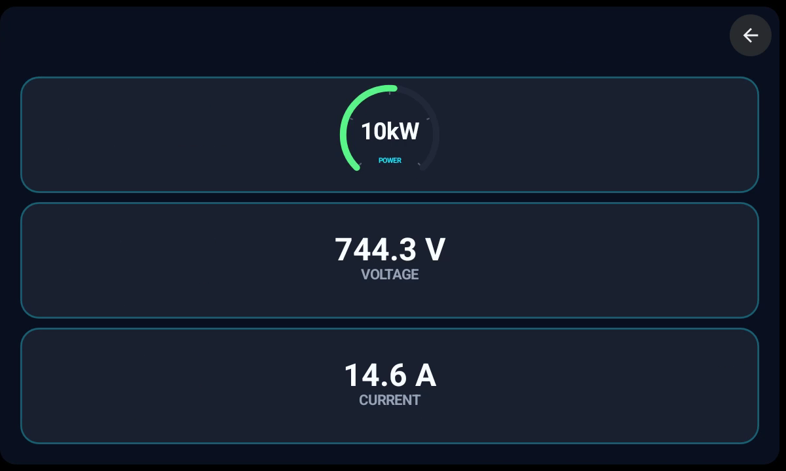
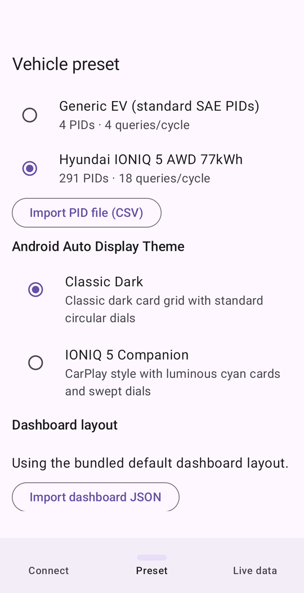
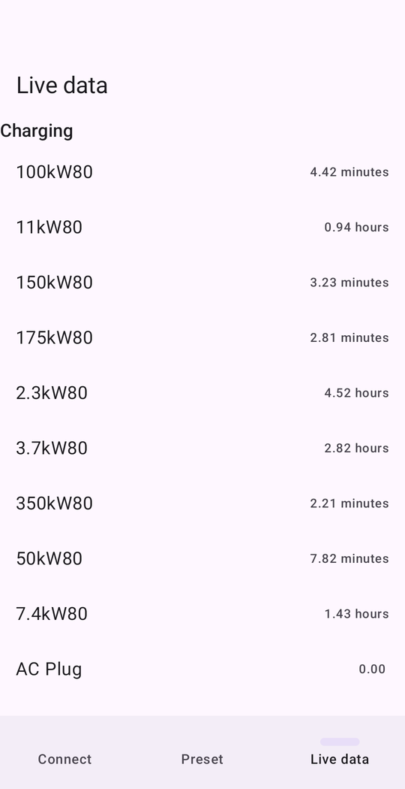

# EV Companion

An Android app that reads live data from an EV over its OBD-II port (via a
Bluetooth ELM327-style adapter) and renders a custom, hand-drawn dashboard on
the car's own screen through Android Auto - state of charge, pack voltage/current,
cell voltages, pack/cabin temperatures, 12V battery, motor RPM, lights, and more,
laid out from a JSON config rather than hardcoded per-screen.

Built and tested against a Hyundai IONIQ 5 (AWD, 77.4 kWh pack). A `generic_ev.csv`
preset ships alongside the IONIQ 5-specific one, but PID coverage and formulas for
any other vehicle are unverified.

## Screenshots

Android Auto (Desktop Head Unit, replaying a recorded IONIQ 5 drive):

| | |
|---|---|
|  |  |
| Driving page, IONIQ 5 Companion theme | Driving page, Classic Dark theme |
|  |  |
| Charging page (tap the title to switch pages) | Detail view (tap a promoted tile) |

Phone app:

| | |
|---|---|
|  |  |
| Preset tab | Live data tab |

## How it works

- **Phone app** (`com.evcompanion.phone`) - connects to a Bluetooth OBD-II adapter, lets
  you pick/import a Torque-format PID CSV ("preset"), and can import a dashboard
  layout JSON with your own tile configuration. Both stay in effect across restarts
  until you pick something else (or tap "Reset to default"), so a non-IONIQ 5 owner
  can tune the app for their car. OBD capture logging, log sharing, and drive replay
  are behind the "Enable debugging features" switch on the Preset tab (off by default).
- **Polling engine** (`core.polling`) - queries the adapter for whichever PIDs the
  active preset and dashboard currently need, at three priority tiers (fast/medium/
  slow) so the active screen stays responsive without flooding the vehicle's CAN
  bus.
- **Android Auto surface** (`car.screens.DashboardScreen`) - instead of using the
  Car App Library's standard templates (lists, grids, messages), this draws
  directly onto the car screen's `Canvas` via `SurfaceCallback`, to get a real
  custom gauge-cluster look: big promoted "hero" tile plus a secondary grid, tap
  any tile to promote it, tap a promoted tile again for a detail graph view.

## Using it

1. Plug an ELM327-compatible Bluetooth adapter into the car's OBD-II port.
2. In the phone app's **Connect** tab, pick the adapter: classic Bluetooth adapters
   must be paired in Android's Bluetooth settings first; BLE adapters are found with
   **Scan for BLE devices**. The app reconnects to the last working adapter on launch.
3. In the **Preset** tab, choose the vehicle preset and Android Auto theme.
4. Open EV Companion from the Android Auto launcher in the car (see the NAVIGATION
   section below for why it must be installed from a Play track to appear there).

### Bring your own car

Everything vehicle-specific lives in two files you can replace from the **Preset** tab.
Both persist across restarts until you choose otherwise.

- **PID file** - a Torque Pro-style custom-PID CSV
  (`Name,ShortName,ModeAndPID,Equation,Min Value,Max Value,Units,Header`). Use
  **Import PID file (CSV)**; the import becomes the active preset. Re-importing a
  file with the same name replaces it, and imported presets can be deleted. See
  `app/src/main/assets/presets/` for examples.
- **Dashboard layout** - a JSON file with `pages` (each a list of `tiles`),
  `detailViews` (what a tile's tap-through shows), and optional `customPids`
  (extra PIDs in the same Torque formula dialect). Tiles reference PIDs by the
  preset's `Name` column, with fallbacks (`"pidNames": ["State of Charge Display", "SOC"]`).
  Use **Import dashboard JSON**; **Reset to default** returns to the bundled layout.
  Start from `app/src/main/assets/dashboards/default.json`; the schema is defined in
  `core/dashboard/DashboardConfig.kt`. Problems in an imported file are listed as
  warnings under the button rather than failing the whole import.

### Debugging features

Turn on **Enable debugging features** (Preset tab) to:

- write every adapter command/response to a capture log (`obd_debug_*.txt`, last 5 kept),
- share the current log via the Android share sheet, and
- replay a captured (or imported) log in place of a live adapter from the Connect tab,
  which runs the whole app, including Android Auto, without a car.

It is off by default; with it off, logs still go to logcat but nothing is written to disk.

## Building

Requires JDK 17+ and the Android SDK (compileSdk 36, minSdk 26).

```sh
./gradlew :app:testDebugUnitTest     # unit tests
./gradlew :app:assembleDebug         # debug APK
./gradlew :app:bundleRelease         # release AAB for a Play track
```

Release signing reads a gitignored `keystore.properties` in the repo root:

```properties
storeFile=keystore/release.jks
storePassword=...
keyAlias=...
keyPassword=...
```

Without that file, release builds fall back to the debug key, which is fine
locally but can't be uploaded to Play.

## Why this needs the NAVIGATION category - and why that's a problem

Custom Canvas drawing (`SurfaceCallback`) on an Android Auto screen is a
capability the Car App Library only grants to apps that declare the
`androidx.car.app.category.NAVIGATION` category. This app does **no real
turn-by-turn navigation or routing** - NAVIGATION is declared purely to unlock
that drawing surface. This is called out directly in the source (see the
`EXPERIMENTAL` comments in `AndroidManifest.xml` and
`car/screens/DashboardScreen.kt`) as a deliberate, personal-use-only stretch of
what the category is for, not an oversight.

**This is why the app will not pass Google Play review for public distribution.**
Google's Play policies for Android Auto apps require that a NAVIGATION-category
app actually provide navigation functionality. An app that declares NAVIGATION
solely to get custom-drawing access is misrepresenting its category, which Play
review is specifically designed to catch - and even if an initial review missed
it, Google has a track record of suspending apps found doing this after the fact.
There is no supported, store-compliant way to get a free-drawing surface on an
Android Auto screen without actually being a navigation app.

**And yet it still has to go through Play to work at all.** Separately from the
review-policy problem, we found - through direct testing on both an unofficial
Android Auto client (`headlessunit`) and a real car head unit over aawireless2+ -
that Android Auto's own app-launcher filters NAVIGATION-category apps out of the
car's app list entirely if they're sideloaded/unverified, even with the phone's
Developer Settings "Unknown sources for Android Auto" option enabled. The *only*
way we found to make the app appear in the car at all was to install it through a
Google Play distribution track - even a private/internal one that only the
developer's own test accounts can see. Play's own internal/closed testing tracks
don't require the full public review a production listing does, which is the gap
this project currently lives in: good enough to install and test with trusted
testers, not something that could ever be published for the general public.

**Net effect:** this is, and is expected to remain, a sideloaded-via-a-private-
Play-track, personal/small-group project - not a public Play Store app - unless
the custom-drawing approach is replaced with the Car App Library's standard
templates (which would mean giving up the hand-drawn gauge-cluster UI for
Android's built-in list/grid/message templates).

**Possible way out (not done yet):** since Car App API level 7, POI-category apps
can draw on the map surface through `MapWithContentTemplate` (with the
`androidx.car.app.MAP_TEMPLATES` permission), which would also stop the app
taking "navigate to..." voice requests away from the real navigation app.
`DashboardScreen` still returns `NavigationTemplate`, which the host only accepts
from NAVIGATION apps, so changing the manifest category alone breaks the
dashboard. The screen has to be ported first, and the port tested on a real
head unit.

## Other known limitations

- **PID formulas are reverse-engineered, not vendor-documented.** The IONIQ 5
  preset's accelerator, brake, and headlight/high-beam PIDs were derived from
  analyzing a single passive drive-log capture (no controlled ground-truth
  test), and may need further correction.
- **One pushed-`Screen` surface limitation, worked around but not fully
  explained.** Android Auto hosts tested so far never handed a *second*,
  separately-pushed `Screen` a working drawing surface (`Surface.lockCanvas()`
  failed on every attempt, indefinitely). The app works around this by never
  pushing a second navigation-template screen - all views render in place on one
  screen - but this is a workaround for an observed host behavior, not a
  guaranteed-universal one.
- **Multi-vehicle support is basic.** Only two bundled presets exist; other cars
  need a user-imported PID CSV and dashboard JSON.
- **Requires an ELM327-compatible Bluetooth OBD-II adapter** (classic or BLE).
  BLE support covers the common GATT layouts (Vgate iCar Pro, FFF0/FFE0 clones);
  others fall back to a generic characteristic scan, which usually but not always works.

## Status

Version 0.12.25. Actively developed for one vehicle and a small group of testers. Not submitted,
and not intended to be submitted, to the Google Play Store for public
distribution for the reasons above.

## License

Copyright Park Four, LLC. Licensed under the
[PolyForm Noncommercial License 1.0.0](LICENSE.md): free to use, modify, and share
for personal and other noncommercial purposes. Commercial use of any kind requires a
separate license from Park Four, LLC.
