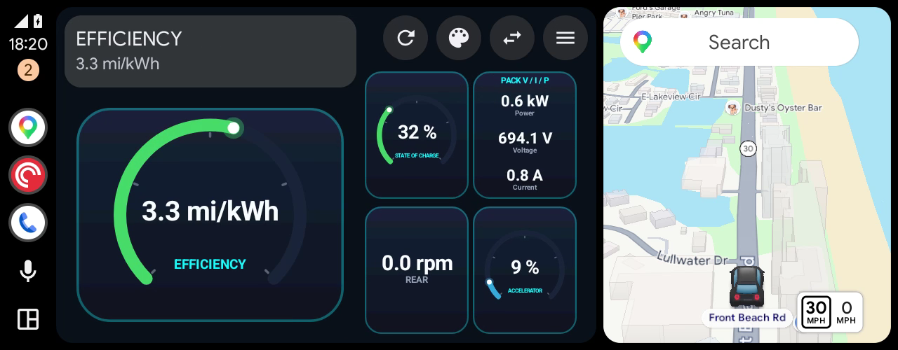
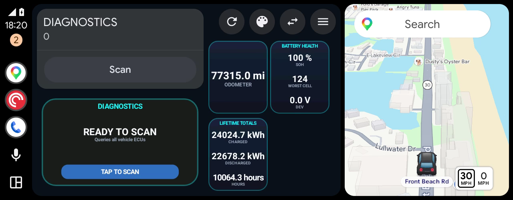

# EV Companion

An Android app that reads live data from an EV over its OBD-II port (via a
Bluetooth ELM327-style adapter) and renders a custom, hand-drawn dashboard on
the car's own screen through Android Auto - state of charge, pack voltage/current,
cell voltages, pack/cabin temperatures, 12V battery, motor RPM, lights, and more,
laid out from a JSON config rather than hardcoded per-screen.

Built and tested against a Hyundai IONIQ 5 (AWD, 77.4 kWh pack). A `generic_ev.csv`
preset ships alongside the IONIQ 5-specific one, but PID coverage and formulas for
any other vehicle are unverified.

## Screenshots

Android Auto (Desktop Head Unit at a wide car-screen size, replaying a recorded IONIQ 5 drive).
The left card belongs to Android Auto and shows the promoted tile's name, value and actions; the
hero is drawn under it and the rest of the page fills the right. Google Maps keeps its own card.





Before 0.13.0 the dashboard used the whole screen (NAVIGATION category; see "Android Auto
category" below for why that changed):

| | |
|---|---|
|  |  |
| Driving page, IONIQ 5 Companion theme (0.12) | Charging page (0.12) |

Phone app:

| | |
|---|---|
|  |  |
| Preset tab | Live data tab |

## How it works

- **Phone app** (`com.evcompanion.phone`) - connects to a Bluetooth OBD-II adapter, lets
  you pick/import a Torque-format PID CSV ("preset"), and can import a dashboard
  layout JSON with your own tile configuration. Both stay in effect across restarts
  until you pick something else (or tap "Reset to default"), so a non-IONIQ 5 owner
  can tune the app for their car. OBD capture logging, log sharing, and drive replay
  are behind the "Enable debugging features" switch on the Preset tab (off by default).
- **Polling engine** (`core.polling`) - queries the adapter for whichever PIDs the
  active preset and dashboard currently need, at three priority tiers (fast/medium/
  slow) so the active screen stays responsive without flooding the vehicle's CAN
  bus.
- **Android Auto surface** (`car.screens.DashboardScreen`) - draws directly onto the
  car screen's `Canvas` via `SurfaceCallback`, inside the Car App Library's
  `MapWithContentTemplate` (POI category). Android Auto shows its own card on the
  driver's side with the promoted tile's name, value and up to two buttons (Full
  screen, Scan/Clear codes, Nearest charger); the app draws the big "hero" tile under
  that card and the rest of the page's tiles to its right. Tap any tile to promote it;
  Full screen opens a detail graph view.

## Using it

1. Plug an ELM327-compatible Bluetooth adapter into the car's OBD-II port.
2. In the phone app's **Connect** tab, pick the adapter: classic Bluetooth adapters
   must be paired in Android's Bluetooth settings first; BLE adapters are found with
   **Scan for BLE devices**. The app reconnects to the last working adapter on launch.
3. In the **Preset** tab, choose the vehicle preset and Android Auto theme.
4. Open EV Companion from the Android Auto launcher in the car. Install it from the Play track
   or as the sideload APK; see "Android Auto category" below.

### Bring your own car

Everything vehicle-specific lives in two files you can replace from the **Preset** tab.
Both persist across restarts until you choose otherwise.

- **PID file** - a Torque Pro-style custom-PID CSV
  (`Name,ShortName,ModeAndPID,Equation,Min Value,Max Value,Units,Header`). Use
  **Import PID file (CSV)**; the import becomes the active preset. Re-importing a
  file with the same name replaces it, and imported presets can be deleted. See
  `app/src/main/assets/presets/` for examples.
- **Dashboard layout** - a JSON file with `pages` (each a list of `tiles`),
  `detailViews` (what a tile's tap-through shows), and optional `customPids`
  (extra PIDs in the same Torque formula dialect). Tiles reference PIDs by the
  preset's `Name` column, with fallbacks (`"pidNames": ["State of Charge Display", "SOC"]`).
  Use **Import dashboard JSON**; **Reset to default** returns to the bundled layout.
  Start from `app/src/main/assets/dashboards/default.json`; the schema is defined in
  `core/dashboard/DashboardConfig.kt`. Problems in an imported file are listed as
  warnings under the button rather than failing the whole import.

### Debugging features

Turn on **Enable debugging features** (Preset tab) to:

- write every adapter command/response to a capture log (`obd_debug_*.txt`, last 5 kept),
- share the current log via the Android share sheet, and
- replay a captured (or imported) log in place of a live adapter from the Connect tab,
  which runs the whole app, including Android Auto, without a car.

It is off by default; with it off, logs still go to logcat but nothing is written to disk.

## Building

Requires JDK 17+ and the Android SDK (compileSdk 36, minSdk 26).

```sh
./gradlew :app:testDebugUnitTest     # unit tests
./gradlew :app:assembleDebug         # debug APK
./gradlew :app:bundleRelease         # release AAB for a Play track
```

Release signing reads a gitignored `keystore.properties` in the repo root:

```properties
storeFile=keystore/release.jks
storePassword=...
keyAlias=...
keyPassword=...
```

Without that file, release builds fall back to the debug key, which is fine
locally but can't be uploaded to Play.

Debug builds use the application ID `com.parkfour.evcompanion.debug` and the name
"EV Companion (Debug)", so they install beside the Play version instead of replacing it
(the two are signed with different keys, so one can't update the other).

### Sideload APK

`./gradlew :app:assembleSideload` builds a release APK for direct download, installed as its own
app (`com.parkfour.evcompanion.sideload`, "EV Companion (Sideload)") beside the Play and debug
builds. It is signed with a dedicated sideload key, never the Play upload key, read from the
environment: `SIDELOAD_KEYSTORE_FILE`, `SIDELOAD_KEY_ALIAS`, `SIDELOAD_STORE_PASSWORD` and
`SIDELOAD_KEY_PASSWORD` (without them it falls back to the debug key).

CI builds it in two places once the secrets below are set on that server:

- **Gitea:** every push to `main` keeps `evcompanion-main-<commit>.apk` as a downloadable
  artifact of the CI run, and each version tag (`v*`) attaches `evcompanion-<tag>.apk` to that
  tag's release (creating the release if needed).
- **GitHub mirror:** each version tag attaches `evcompanion-<tag>.apk` to that tag's release.

The secrets, set separately on each server: `SIDELOAD_KEYSTORE_B64` (the keystore,
base64-encoded), `SIDELOAD_KEY_ALIAS`, `SIDELOAD_STORE_PASSWORD` and `SIDELOAD_KEY_PASSWORD`. Every release must be signed with the
same key, or testers can't install an update over their current copy, so back the key up.

Since 0.13.0 the app is a POI-category app, and Android Auto shows sideloaded POI apps in
cars (seen with a sibling Park Four app), so this APK is meant to work in a car as well as on the
phone and in the Desktop Head Unit. The first car check of the POI sideload build is still to
be done; until then the Play track is the proven route into a car.

### Testing Android Auto without a car

Google's Desktop Head Unit (DHU, SDK package `extras;google;auto`) shows the Android Auto
screen on your computer, using the phone's own Android Auto:

1. On the phone, enable Android Auto developer mode (Android Auto settings → tap **Version**
   about 10 times), turn on **Unknown sources** in its developer settings, then choose
   **Start head unit server** from its menu. Repeat that last step after every phone reboot.
2. `adb forward tcp:5277 tcp:5277`, then run `desktop-head-unit` from the SDK's
   `extras/google/auto` folder. `-c config/default_wide.ini` approximates a wide car screen.
3. To see live values without a car, use a recorded drive: turn on debugging features and pick
   **Replay a captured drive** on the Connect tab.

On Linux the DHU needs `libc++.so.1`; if it isn't installed, the Android NDK has one
(`ndk/<version>/toolchains/llvm/prebuilt/linux-x86_64/lib`), passed via `LD_LIBRARY_PATH`.
USB mode (`--usb`) can fail at the TLS handshake (it did on a phone with Advanced Protection
on); the head-unit-server route above works.

## Android Auto category: POI (since 0.13.0)

Drawing your own graphics on an Android Auto screen (`SurfaceCallback`) is only available to a
few app categories. Up to 0.12 this app declared **NAVIGATION** to get a full-screen surface,
although it does no turn-by-turn routing. That had three problems:

- **Play review.** Google requires NAVIGATION apps to actually navigate; claiming the category
  just for the drawing surface is the kind of mismatch review rejects or later suspends.
- **It took over navigation.** Android Auto treated the app as *the* navigation app: Google
  Maps lost its card on wide screens, and "navigate to..." voice requests could go to it.
- **Sideloaded builds never showed up in a car.** Android Auto hides sideloaded NAVIGATION
  apps from the car's launcher even with "Unknown sources" on (seen on 2026-10-26 and again
  on 2026-11-01, with both a debug build and a release-signed sideload APK). Only Play-installed
  builds appeared. Google's Desktop Head Unit did show sideloaded builds, so it is not a reliable
  stand-in for a car on this point.

Since 0.13.0 the app declares **POI** (point of interest; it lists nearby EV chargers and hands
them to your navigation app) and draws through `MapWithContentTemplate` (Car App API level 7+,
so older Android Auto hosts can't run it). The trade-offs:

- Android Auto always shows its own card on the driver's side. The app can't remove or resize
  it, and the card can't show a picture, so it carries the promoted tile's name, value and
  buttons, and the hero is drawn on the surface underneath it. There is no full-screen view,
  even when parked.
- Taps on the drawing only reach the app because it adds a map controller, which shows a pan
  button.
- The card's height isn't reported to the app, so the hero's position under it uses heights
  measured in the Desktop Head Unit and may need adjusting on some screens.
- Google Maps keeps its card, and the app no longer competes for navigation requests.
- Android Auto shows sideloaded POI apps in cars (seen with a sibling Park Four app), so builds
  can be distributed outside Play. This app's first car check as a POI build is still to come.

## Other known limitations

- **PID formulas are reverse-engineered, not vendor-documented.** The IONIQ 5
  preset's accelerator, brake, and headlight/high-beam PIDs were derived from
  analyzing a single passive drive-log capture (no controlled ground-truth
  test), and may need further correction.
- **One pushed-`Screen` surface limitation, worked around but not fully
  explained.** Android Auto hosts tested so far never handed a *second*,
  separately-pushed `Screen` a working drawing surface (`Surface.lockCanvas()`
  failed on every attempt, indefinitely). The app works around this by never
  pushing a second map-template screen - all views render in place on one
  screen - but this is a workaround for an observed host behavior, not a
  guaranteed-universal one.
- **Multi-vehicle support is basic.** Only two bundled presets exist; other cars
  need a user-imported PID CSV and dashboard JSON.
- **Requires an ELM327-compatible Bluetooth OBD-II adapter** (classic or BLE).
  BLE support covers the common GATT layouts (Vgate iCar Pro, FFF0/FFE0 clones);
  others fall back to a generic characteristic scan, which usually but not always works.

## Status

Version 0.13.0. Actively developed for one vehicle and a small group of testers, distributed
through a Google Play testing track and as a sideload APK (see "Sideload APK"). Not yet
submitted to Google Play for public distribution.

## License

Copyright Park Four, LLC. Licensed under the
[PolyForm Noncommercial License 1.0.0](LICENSE.md): free to use, modify, and share
for personal and other noncommercial purposes. Commercial use of any kind requires a
separate license from Park Four, LLC.
